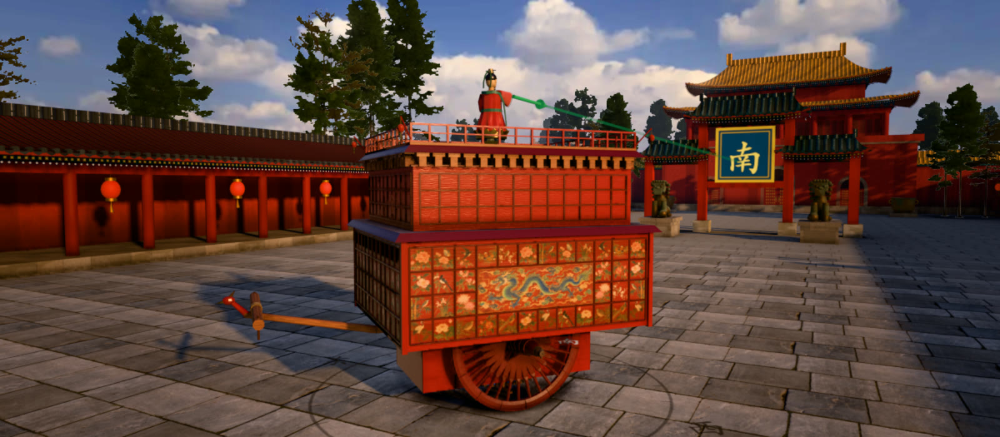
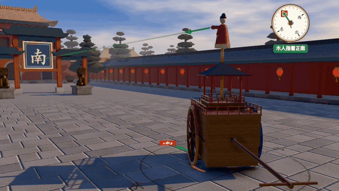

# 指南车：3D 仿真教学网页

**中文** · [English](README.en.md)



<p align="center"><br><sub>车原地转一整圈，木人一直指着南门（镜头不动）</sub></p>

一辆两轮车，车上站着一个木人。车怎么拐弯，木人的手都一直指着南方。它里面没有磁铁，只有齿轮。

这个项目把中国古代的**指南车**做成能在浏览器里开、能透视、能拆开看齿轮的 3D 仿真，并配了一套给**小学中高年级（9–12 岁）**的中文课件。大字、触屏友好，适合课堂上用平板。

## 课件

六节课，内容在 [`js/teach/lessons.js`](js/teach/lessons.js)，格式见 [`docs/lesson-format.md`](docs/lesson-format.md)：

1. **指南车是什么**：木人总指南；它不是指南针，也不是司南。
2. **自己开一开**：当车夫，拐弯、掉头、画一条路让车走。
3. **转弯时两个轮子**：先看两个小朋友手拉手绕圈，外圈的人走得多；再看车的两个轮子。
4. **齿轮怎么「记账」**：齿轮记下两个轮子差了多少，让木人反着转回去。
5. **古人的两种造法**：《宋史》写的燕肃车（1027）和现代人猜的差动式。
6. **它会出错吗**：轮子尺寸不对、地面打滑，木人都会越走越偏。

## 在自己电脑上运行

需要 Node.js 22 以上和 pnpm。

```sh
pnpm install
pnpm vendor      # 把 three.js 复制到 vendor/（仓库里已有一份，可跳过）
pnpm serve       # 本地静态服务器
```

然后用浏览器打开 <http://localhost:8080>。没有构建步骤，改了文件刷新页面就行。

## 分享一条路线

在「自己开」里画一条路、选好造法和毛病，按画面右上角的「复制链接」。链接把造法、毛病、地面、快慢、透视、拆开程度和画的路线都存在 `#` 后面（例：`#s=1&m=song&wl=1.05&v=top&p=…`），别人打开就从同一个起点沿同一条路开。编码见 [`js/app/share.js`](js/app/share.js)。

另外，`?free` 直接打开「自己开」，`?lesson=N&step=K` 打开第 N 课第 K 步；地址栏会跟着当前课和步变，老师可以直接复制当前这一步的链接。英文版是 [`en.html`](en.html)，按顶栏的 EN / 中文 切换时地址也跟着换。

## 发布

站点放在 GitHub Pages：<https://hoveychen.github.io/zhinanche/>（英文 <https://hoveychen.github.io/zhinanche/en.html>），源码在 <https://github.com/hoveychen/zhinanche>。整个仓库就是站点，没有构建步骤：在仓库设置的 Pages 里选「从分支部署」、`main` 分支、根目录 `/` 即可。根目录的空文件 `.nojekyll` 不能删：没有它 GitHub Pages 会用 Jekyll 处理站点，而 Jekyll 默认不发布 `vendor/`，three.js 就加载不到了。

地址写在三处，换地方时一起改（`tests/entry.test.js` 会核对它们一致）：

- [`js/site.js`](js/site.js) 的 `site` 和 `repo`；有 `repo` 时首页课程列表下面会出现「源代码」链接。
- [`index.html`](index.html)（中文）和 [`en.html`](en.html)（英文）`<head>` 里的链接预览：`og:url`、`og:image` / `twitter:image` 和三条 `hreflang` 都是绝对地址，多数网站抓预览只认绝对地址。
- 发到英文网站（Reddit 等）用 `…/en.html`（GitHub Pages 上 `…/en` 也行），预览就是英文的。

预览图 `images/og.jpg`、`images/og.en.jpg`（1200×630）、README 头图和动图都是从页面里的 3D 场景截的。

## 测试

```sh
pnpm test        # node:test：仿真运动学（tests/sim/）和课件数据（tests/lessons.test.js）
pnpm typecheck   # tsc 按 JSDoc 做类型检查
uvx reuse lint   # 许可合规检查（或 pip install reuse && reuse lint）
```

3D 模型由 Blender 脚本生成（需要装 Blender，可用 `BLENDER=/path/to/blender` 指定）：

```sh
pnpm build:model   # 生成 assets/*.glb
pnpm check:model   # 齿轮干涉检查
```

## 目录结构

```
index.html            页面入口（importmap 加载 vendor/three）
js/sim/               纯逻辑仿真，不依赖 three.js
  chariot.js            车的运动学，差动式和燕肃离合式两种机构
  drive.js              开车方式，包括燕肃车的「绕内侧轮转弯」
  route.js              沿画出的路线行驶
  scenarios.js          课件和测试共用的路线（MANOEUVRES）
  params.js             读取 params/chariot.json
js/teach/             课件：lessons.js（六节课的数据）、types.js（格式）
js/scene/, js/app/    3D 场景和课件播放器（其他子任务在做）
params/chariot.json   唯一参数源，每个数都标了「有文献 / 估计 / 自定」和出处
assets/               3D 模型 GLB（由 blender/scripts 生成）
images/lessons/       课件图片（第三方，逐文件标注许可）
vendor/three/         three.js，原样复制自 npm
tests/                node:test 测试
tools/                vendor.mjs、serve.mjs
docs/                 课件格式、3D 模型接口、出处标签、许可说明
design/decisions/     设计决策记录
research/             调研报告、古书原文、书目
LICENSES/             许可证全文
```

## 模型有多忠实？

**一句话：** 机构的动作是按运动学精确算的；燕肃车的齿数照《宋史》原文；但「古人到底怎么造的」，今天没有人能完全确定。课件把这一点当成教学内容来讲。

**有文献的（《宋史》卷 149）：**

- 燕肃车（1027）：车轮直径 6 尺；附足立子轮 24 齿；左右小平轮各 12 齿；中心大平轮 48 齿；离合式，转弯时车辕把外侧车轮接上。拐 90° 弯时大平轮转 12 齿、即四分之一圈，这也是原文的例子，仿真和它完全一致。
- 吴德仁车（1107）的齿数（大平轮 100 齿等）只在课件里提到，**没有做成模型**，因为原文没写清齿轮怎么接。
- 指南车不用磁石：宋史两段造法里只有齿轮和离合件。

**推定的：**

- **差动式是 20 世纪的推测**（G. Lanchester，1947），没有宋代原文支撑。因为它在任何路线上都准，本项目**默认用差动式**，宋史燕肃式可以切换。理由见[决策 0001](design/decisions/0001-which-reconstruction.md)。
- **燕肃车的轮距**原文没给。取 6 尺（等于轮径），是让齿数比成立的条件（Needham 的分析）。
- 燕肃车要准，拐弯时车夫必须让内侧车轮停住、车绕着它转。这是推理出来的，原文没写。仿真里做成「车夫帮忙」开关，宋史模式下默认打开；关掉它，木人就会偏。
- 车夫帮忙时，燕肃车也不是一点不差。每次放下小平轮，它的齿要重新对进齿缝，会把大平轮拨动一点（仿真里按真实齿位推到最近的齿槽，每次最多半个齿、3.75°，确定，不用随机数），拐弯多了木人会慢慢偏几度。这是刚体物理复核得出的（[物理报告](research/physics/REPORT.md)），真车还会偶尔错一整个齿，仿真没算，所以真车偏得比仿真多一些。差动式的齿轮不抬不落，没有这一项。见[决策 0007](design/decisions/0007-song-clutch-error.md)。
- 燕肃车的小平轮、大平轮的齿上下削成屋脊，所有齿的齿顶倒角，这样小平轮落下时不会被齿面顶住。这是物理复核推出来的改法，古籍没写齿形。

**为教学放大或简化的：**

- 差动式的全部尺寸（齿数、和燕肃车相同的轮径与轮距）都是本项目自定。
- 车轮、轴和齿轮按古制重建：30 根两段辐、腰鼓形牙、长毂加铁箍、轮碟、锥轴軎辖、伏兔，出自《考工记》及鄭注、秦陵二号铜车的实测（按轮径折算）和《营造法式》；齿是径向方块齿、穿辋打楔，出自浙江木齿轮实物（Hommel 1937）、《农书》和《天工开物》。宋代文献对辐数、毂、牙一字未提，所以这些是「按古制推定」，不是宋代实物；毂为了给齿轮室让位比古制短。见[决策 0006](design/decisions/0006-cad-level-chariot.md)和[考据报告](research/cad-level/REPORT.md)。
- 车身外形按《宋史》的词（赤质、重台、勾阑、镂拱、香囊、仙人、单辕凤首）和《大驾卤簿图书》的画，尺寸借同为宋代指南车的吴德仁本。箱上画了《宋史》写明的「两箱画青龙、白虎，四面画花鸟」，但哪边画龙、哪边画虎、画心多大是推断，**龙、虎、花鸟的图样是本项目用图像模型生成的**，没有宋代实物可依；箱底下的齿轮室和车毂漆成红色也是推断。木人照宋画仙人的大意重刻，只为好看、好读。见[决策 0008](design/decisions/0008-chariot-readability.md)。宋史式的离合吊绳画成绕过小滑轮的绞索、顶台方孔上加的朱漆圆座，都是为了近看像实物自己加的，原文没写；见[决策 0011](design/decisions/0011-closeup-realism-and-highlight.md)。
- 第三课的两个小朋友照宋画婴戏图的大意（双丫髻、交领短襦），冰面、零件高亮的光晕、透视时的箱棱都是教学用的画法，不是考据。
- 故障演示里的尺寸误差和打滑（轮距大 10%、一个轮子大 5%、打滑 20%）故意放大，让偏差几步之内就能看出来。真车的误差小得多，但会在长路上一点点攒起来。
- 宋尺取 0.31 米，只用于界面上换算「米」。
- 庭院、牌楼和天空是布景，不是某座真实宫殿的复原。天空、地砖、墙、瓦、车木用的是实拍扫描（Poly Haven，CC0），做旧、阴影和天光遮蔽是程序生成或在加载时烘焙的，只为看起来像实拍；见[决策 0004](design/decisions/0004-realtime-photo-look.md)。地砖按行错缝、每块深浅不同，远景的雾，西墙外让院子落进树影、只把车留在光里的那片树林，也都是为画面安排的；见[决策 0013](design/decisions/0013-art-round-air-reds-light.md)。
- 院里院外的松和冷杉是 Poly Haven 的 CC0 树模型在 Blender 里从 16 个方向渲成的贴片，树的位置和成团方式是为画面排的。屋面的筒瓦垄、檐口的瓦当滴水椽头、檐下的斗拱是按清式做法的大意自己画的（高度场烘焙 + 实拍釉面颗粒），只求常用镜头下读得出来：垄距、斗拱攒数和彩画都没有按某座建筑考据；牌楼还是原来的平面屋顶，只贴了瓦和斗拱。见[决策 0005](design/decisions/0005-trees-and-eaves.md)。

每个参数的出处和置信度都在 [`params/chariot.json`](params/chariot.json) 里，标签含义见 [`docs/sources.md`](docs/sources.md)。调研的依据和没覆盖到的地方见 [`research/REPORT.md`](research/REPORT.md)，书目见 [`research/sources/bibliography.md`](research/sources/bibliography.md)。

## 许可

- 代码：[Apache-2.0](LICENSE)
- 课件文字、3D 模型、参数、文档：[CC BY-SA 4.0](LICENSES/CC-BY-SA-4.0.txt)
- three.js：MIT
- 天空和材质扫描：Poly Haven，CC0（`tools/assets/build_photo.py` 下载并压缩）；车上的铁件用 rusty_metal_04（Amal Kumar），车漆的光泽（擦痕、划痕、板缝）用 lacquered_cherry_wood（Jenelle van Heerden、Rico Cilliers）
- 车的遮蔽图集（`assets/photo/chariot-*-ao-*.webp`）：由本项目的模型烘焙，CC BY-SA 4.0（`pnpm build:model`）
- 树模型：Poly Haven 的 pine_tree_01、fir_tree_01（Rico Cilliers 建模，Rob Tuytel 摄影），CC0（`tools/assets/fetch_models.py` 下载，`blender/scripts/render_impostors.py` 渲成贴片）
- 屋瓦和斗拱贴图：本项目自绘的高度场，叠 Poly Haven 扫描（clay_roof_tiles_02、灰泥）的颗粒，CC BY-SA 4.0（`tools/assets/build_photo.py`）
- 课件图片：逐文件标注。三才图会（公有领域）；Andy Dingley 摄的伦敦科学博物馆模型（CC BY 3.0）；SSR2000 摄的台湾国立自然科学博物馆齿轮（CC BY-SA 3.0）

详见 [`docs/licensing.md`](docs/licensing.md) 和 [`REUSE.toml`](REUSE.toml)。参照了 [leibniz-stepped-reckoner](https://github.com/wixette/leibniz-stepped-reckoner) 的做法。
