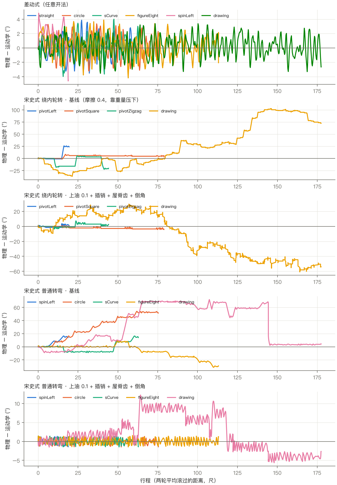
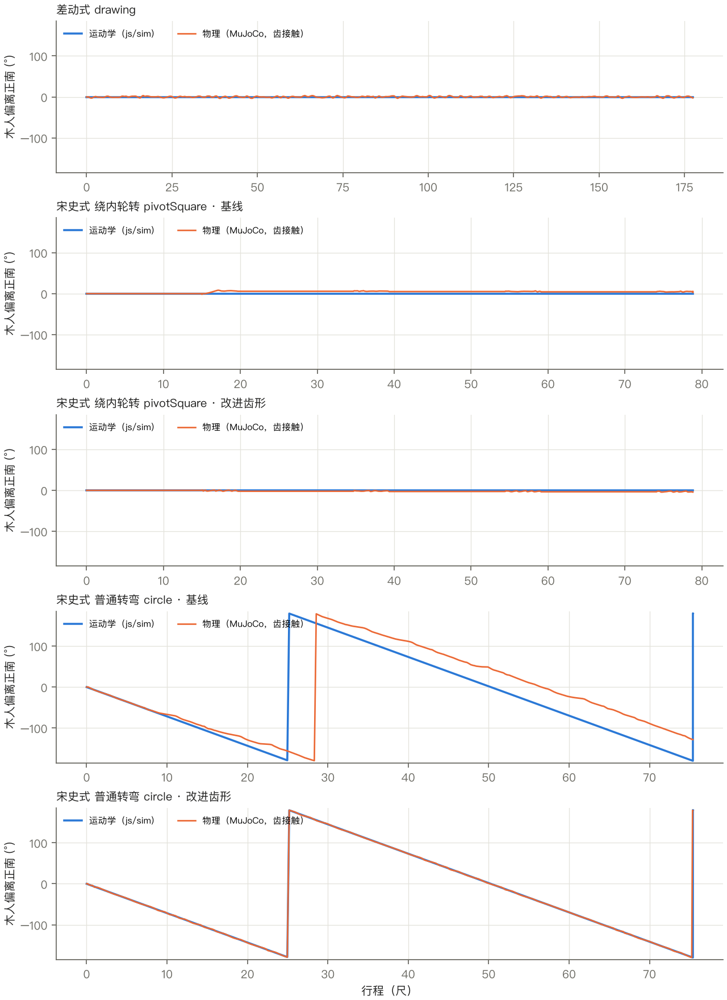
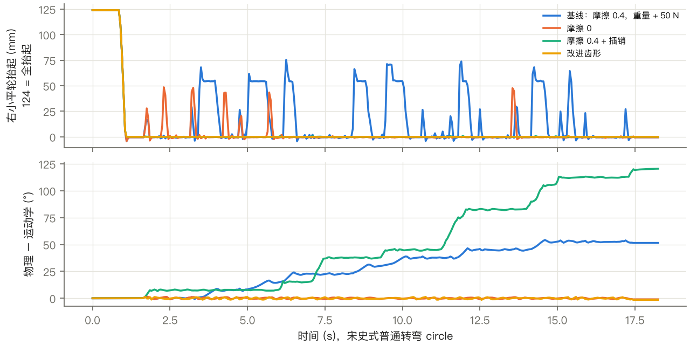
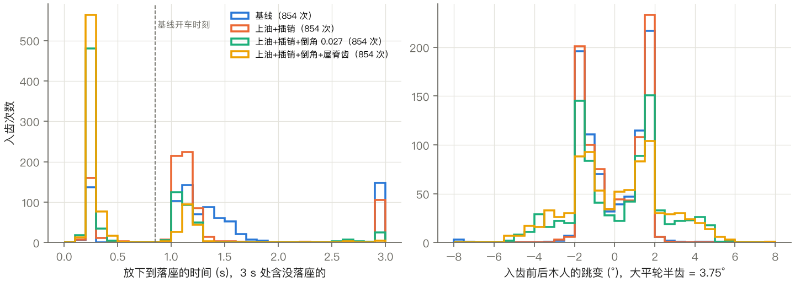
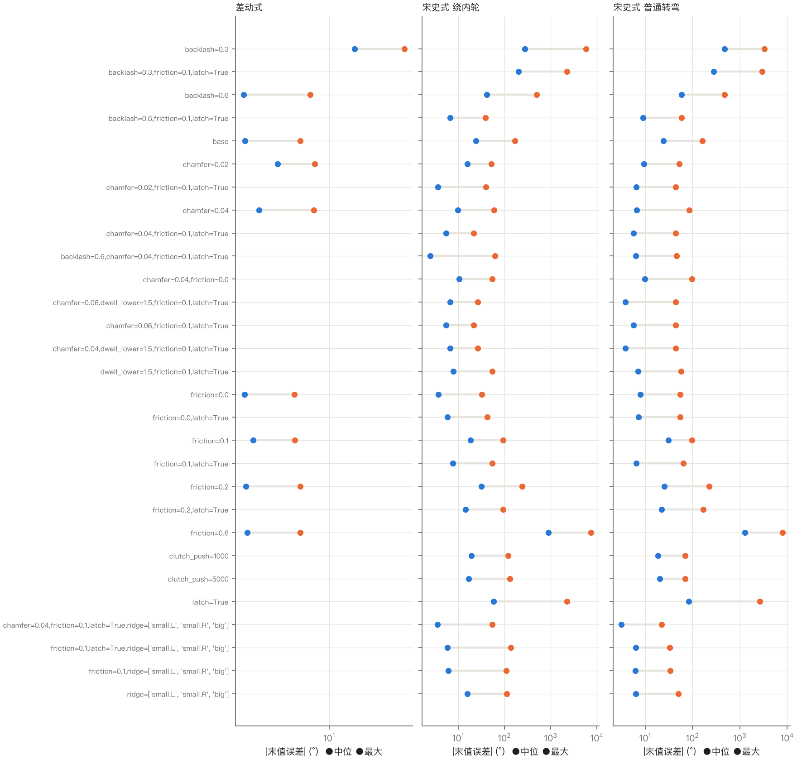

# 指南车两种机构的离线刚体物理验证

P16 · 分支 `prd/physics-check` · 2026-10-21

老板的问题是：「驱动是假的动画，还是真的通过物理引擎模拟，确定机制准确有效的呀？」

网页里的驱动是运动学：木人角直接按齿比从两轮转角算出来，齿和齿之间没有接触。本报告做的是另一件事，离线、不进网页：

- 把两种机构的齿轮做成刚体，齿做成实体方块齿；
- 车轮转角和车身转角照网页里的路线规定好，其余齿轮**只靠齿接触**推动（MuJoCo 3，带摩擦）；
- 量物理木人和运动学木人差多少，以及会不会卡死、跳齿、顶齿。

几何用的是 CAD 版参数，见第 1 节。

## 结论

| # | 结论 | 关键数字 | 置信度 |
|---|---|---|---|
| 1 | **差动式在真实齿接触下成立。** 木人误差只是齿隙里的晃动，有上限，不随行程累积。没有跳齿，也没有卡死。 | 29 条路线（直行、原地转、大圆、S 弯、8 字、画线、20 条随机），最长 180 尺：误差最大 5.07°，末值绝对值最大 4.90°；穿透 ≤ 0.75 mm；摩擦 0–0.6 时最大误差 ≤ 5.17° | 高（数据） |
| 2 | **宋史式的齿比是对的，但按现在的 CAD 齿形、只靠重量压住小平轮，在木对木的摩擦（0.4）下不成立。** 小平轮会被齿面摩擦顶起来，脱开后再落下就丢齿，误差一路累积。 | 普通转弯 circle：误差末值 51.5°，小平轮被顶起 6 次，每次 40–75 mm。20 条随机路线末值中位 34–36°，最大 169° | 高（数据，机理已用摩擦 0 对照核实） |
| 3 | 上面那条是**摩擦自锁**，压得再重也压不住。立子轮和小平轮的轴线相交且互相垂直，方块齿进出啮合时接触角很陡。不锁的话，小平轮会被摩擦顶起来；用插销锁住，齿就卡死并被硬穿过去。 | circle：摩擦 0 时末值 −1.0°；摩擦 0.4 加插销时末值 120°；摩擦 0.1 加插销时末值 −1.0°。压力 50 N 时末值 51.5°，1000 N 时 −0.96°，但随机路线末值中位仍有 24–36°。自由间隙：立子轮/小平轮这一对，在某些转角下只剩小平轮节距的 3.75% | 高（数据）；「自锁」是对数据的解释（推断） |
| 4 | **离合入齿是宋史式真正的难点。** 在基线齿形下，83% 的入齿是齿面顶在齿面上，要等车开起来才滑进去，约 2.9% 一直没落座，等到下次抬起。每次入齿平均带来约 0.9 次整齿台阶（约一个大平轮齿，7.5°）。 | 854 次入齿：开车前没落座 710 次；落座延迟中位 1.18 s（开车时刻是 0.85 s）；永久台阶 755 次 | 高（数据） |
| 5 | **建议改齿形（3D 模型要跟着改），再加润滑或插销。** 小平轮和大平轮的齿，上下两面削成 45° 屋脊；所有宋史式齿的齿顶倒角 0.027 尺（齿顶宽只有 0.06，这已是上限）。改了以后，开车前没落座的降到 21%，每次入齿的整齿台阶降到 0.03–0.04 次，随机路线末值中位降到 7°。 | 见第 5.4 节的表 | 中高（数据；只在这一套几何上试过） |
| 6 | **即使改好，宋史式在多次转弯后仍有几度到二十几度的误差。** 每次入齿都会把大平轮重新对到最近的齿槽，偶尔错一个齿，这是离合式固有的。差动式没有这个问题。 | 最佳设定下 20 条随机路线（每条 16–19 次入齿、270–480 尺）：末值中位 7.0° / 6.7°，最大 28° / 22° | 中高（数据） |
| 7 | 宋史式「普通转弯」本来就该指偏。只要小平轮压得住，物理结果和运动学一致。 | 最佳设定下普通转弯的命名路线末值 ≤ 2.6°；基线下 circle 51.5° 的偏差全部来自丢齿 | 高（数据） |
| 8 | **齿隙不能再收**：48% 是这套齿形能用的下限附近；30% 时两种机构都穿透 40 mm、卡死。齿隙放到 60%，差动式只是晃得更大（≤ 6.6°），宋史式没有明显好处。 | 见第 6 节 | 高（数据） |
| 9 | REPORT §6.3 的方块齿原样（宽 0.5p、长 1.0p、厚 0.2）**装不进去**，静态就互穿 0.035–0.064 尺（11–20 mm）；CAD 版几何是静态全部清开的。 | 第 2 节 | 高（数据） |

数字说明：**误差** = 物理木人角 − 运动学木人角，单位是度。运动学木人角由实际施加的两轮转角、按 js/sim 的齿比重新算出；它与 js 导出的末值相差 < 1e-8°，所以误差反映的全是齿接触的影响。**偏离** = 木人相对正南的角度。**行程** = 两轮平均滚过的距离，单位是尺。



## 1. 几何版本与方法

**几何**：
- 本报告的结果都用 `prd/cad-chariot` 在 af674e6 提交的几何。它已合进 main（03d51de），合并时 `params/` 和 `blender/scripts/lib/layout.py` 没有改动（`git diff af674e6 03d51de -- params blender/scripts/lib/layout.py` 为空）。
- 跑批读的是从 03d51de 导出的快照：`git archive 03d51de params blender/scripts/lib`。快照的静态间距与 cad-chariot worktree 上测的完全一致。
- 前几组 run 读的是 cad-chariot worktree，后来那个 worktree 被删了，剩下的改读快照。base 组在两种来源上都跑过，两边数字一样。

**两种机构的齿**（来自 `layout.py --json`）：
- 宋史式（燕肃本，齿数 24 / 12 / 48）：梯形方块齿，根宽 0.11、顶宽 0.06、厚 0.15（小平轮 0.2），齿顶高 0.15、齿根高 0.2。齿隙按节圆算是 48% 节距（0.151 尺）。
- 差动式：根宽 0.075、顶宽 0.045、厚 0.1，齿顶高 0.08；ring 齿隙 56%，小轮 51%。
- 每个齿轮还有一个实心轮辋盘，所以齿顶碰到对面轮辋会被挡住。

**MuJoCo 模型**（`model.py`，参数驱动，读任意一个 checkout 的 layout）：
- 单位是米（1 尺 = 0.31 m），木材密度 700 kg/m³；
- 齿与齿的摩擦默认 0.4（木对木干摩擦）；木人轴摩擦 0.5 N·m、阻尼 0.5 N·m·s；
- 接触 solref 0.002 s，步长 0.5 ms，implicitfast 积分，椭圆摩擦锥。

**规定运动与自由度**：
- 车身绕竖轴的转角和两轮转角每一步直接写入，包括位置和速度，所以车身转动带来的惯性效应是真实的。
- 其余齿轮都是自由铰链，只受齿接触推动。
- 宋史式小平轮另有一个竖直滑动关节：抬起时用 PD 拉到 0.4 尺高；放下时靠自重（约 11 kg，112 N）再加 `clutch_push` 往下压，默认 50 N。
- `latch` 设定表示落座后把滑动关节锁死，模拟插销。

**时间安排**（`sim.py`）：
- 轮速上限 2 rad/s，约等于网页里每秒 6 尺。
- 每次离合切换都先停车，再按「静置 0.35 s → 抬起 0.3 s → 放下 0.5 s → 静置 0.35 s」的顺序走，然后才开车。这一段在运动学里是瞬间完成、轮子不动的，所以不改变运动学木人角。
- 参考轨迹用 0.15 s 的 box 滤波平滑两次，路线开头先静止 0.5 s。

**路线**（`export_routes.mjs`）：直接从 js/sim 导出，每一步记录两轮转角、离合状态和运动学木人角。分三组：

| 组 | 命名路线 | 加上 |
|---|---|---|
| 差动式（任意开法） | 9 条 | 20 条随机 |
| 宋史式「车夫帮忙」，只绕内轮转 | 6 条 | 20 条只含直行和绕内轮转的随机路线 |
| 宋史式「普通转弯」 | 5 条 | 20 条随机 |

**判据**：
- **永久台阶**：误差的 1 s 中位数，在 1 s 内变了超过 0.75 个木人侧节距（宋史式 5.6°，差动式 7.5°），而且 3 s 后仍在。齿隙里来回晃不算。
- **落座**：小平轮离工作高度 < 2 mm。
- **入齿跳变**：从放下前到开车时刻，误差的变化。

**建模的坑**（复现时要注意）：
- geom 的 margin 和 gap 必须是 0。给 margin 的话，box-box 碰撞器会把相距 4–7 mm 的齿对也交给求解器出力，造成虚假卡死、22 mm 穿透和能量注入。
- 「锁住」不能用大的下压力来模拟。2 万 N 会压穿滑动关节的软限位（−26 mm），而且小平轮仍会被顶起 28 mm。所以 `latch` 是运动学锁。



## 2. 静态：齿装不装得进去（`clearance.py`）

按精确传动比摆好位置，扫一个以上的齿周期，取每对啮合的最小间距（负数表示互穿）。

| 几何 | 宋史 立子轮/小平轮 | 宋史 小平轮/大平轮 | 差动 冠轮/侧轮 | 差动 侧轮/行星小轮 |
|---|---|---|---|---|
| main 16a1781 + REPORT §6.3 方块齿原样 | **−0.064 尺** | **−0.058 尺** | −0.035 / −0.051 尺 | **−0.061 尺** |
| CAD 几何（03d51de） | +0.0074 尺 | +0.010 尺 | +0.050 / +0.036 尺 | +0.015 尺 |

- 齿顶到对面轮辋：CAD 几何 ≥ +0.03 尺。
- 交错轴、平行轴上的径向方块齿，传动比不是常数，所以需要大齿隙（旧几何的扫描结果在 `out/clearance.json`）：
  - 齿长 1.0p、厚 0.2 时，宋史式要 46–50% 节距，差动小轮要 60–66%；
  - 齿长 0.64p、厚 0.15 时，宋史式要 24–28%，差动式要 36–40%。
- **自由间隙**（`clearance.free_play`）：固定主动轮，看从动轮能活动多少。CAD 几何上：
  - 宋史 立子轮/小平轮：最窄处只有小平轮节距的 **3.75%**，最宽 16%；
  - 宋史 小平轮/大平轮：7.5–19%；
  - 差动 冠轮/侧轮：22–33%；侧轮/小轮：16–25%。
  - 宋史式第一对几乎没有余量，这是第 3 节那些问题的几何根源。

## 3. 差动式

| 设定 | 组 | 条数 | 误差最大（中位 / 最大） | 末值绝对值（中位 / 最大） | 最大穿透 |
|---|---|---|---|---|---|
| 基线（摩擦 0.4） | 命名 | 9 | 4.35° / 4.85° | 2.06° / 4.56° | 0.50 mm |
| 基线 | 随机 | 20 | 4.97° / 5.07° | 2.24° / 4.90° | 0.75 mm |
| 摩擦 0 / 0.1 / 0.2 / 0.6 | 全部 | 29 | 最大 5.17° / 5.09° / 5.03° / 4.97° | ≤ 4.9° | ≤ 0.78 mm |
| 齿隙 60% | 全部 | 29 | 最大 6.64° | ≤ 6.1° | 0.87 mm |
| 倒角 0.02 / 0.027 | 全部 | 29 | 最大 7.53° / 7.73° | ≤ 6.9° | ≤ 0.89 mm |
| **齿隙 30%** | 随机 | 20 | **最大 70°** | 中位 34° | **41 mm（卡死、穿齿）** |

- 误差在 ±5° 以内来回晃，正负都有，不累积。画线路线 177 尺、反复换向，末值 −2.7°。
- 被判成永久台阶的只有 1 次（random2）：误差从 +3° 摆到 −4.6°，整条路线 |误差| 从没超过 5.0°，属于齿隙两侧换边，不是跳齿。
- 倒角会增大实际齿隙，所以误差反而变大，差动式不需要倒角。
- 复现：`sh sweeps.sh`（base、friction、backlash、chamfer 几组）；`python summarize.py out/results-cad.json`。

## 4. 宋史式：小平轮被顶起，或者卡死

基线（摩擦 0.4，重量 + 50 N）下的普通转弯 circle：

- 右小平轮落座以后被反复顶起 40–75 mm（全抬起是 124 mm）；
- 每次脱开都丢齿，误差一级一级往上加，末值 51.5°；
- 6 次永久台阶，最大穿透 1.5 mm，轮上的峰值约束力矩约 1.2×10⁵ N·m（冲击）。



| circle 的设定 | 误差最大 | 末值 | 永久台阶 |
|---|---|---|---|
| 基线：摩擦 0.4，重量 + 50 N | 54.2° | 51.5° | 6 |
| 下压 200 / 1000 / 5000 / 50000 N | 9.2 / 1.7 / 2.4 / 2.5° | 6.5 / −1.0 / −0.8 / −0.2° | 1 / 0 / 0 / 0 |
| 摩擦 0 / 0.05 / 0.1 / 0.15 / 0.2 / 0.6（不锁） | 1.7 / 1.7 / 31 / 39 / 31 / 466° | — | — |
| 插销锁住，摩擦 0 / 0.1 / 0.2 / 0.4 | 1.7 / 1.5 / 1.4 / **121°** | −1.0 / −1.0 / −0.9 / **121°** | 0 / 0 / 0 / 7 |

**解释**（推断，但每一步都有对照数据）：

1. 立子轮的轴是 Y 向、过 z=3，小平轮的轴是 Z 向、过 y=−2.05，两轴相交且垂直，相当于一对用径向方块齿近似出来的伞齿轮。
2. 立子轮的齿是竖着的柱，它在 XZ 平面里转过啮合点时，齿面法向带竖直分量；齿相对小平轮齿上下滑动，摩擦力也是竖直方向的。
3. 第 2 节的自由间隙显示，这一对在某些转角下只有 3.75% 节距的余量，所以接触角会非常陡。
4. 摩擦 0.4 时，竖直方向的力超过小平轮的重量加压力，它就被顶起来。锁住不让它抬，接触就落在摩擦锥里自锁：齿既推不动小平轮，也没法让开，只能被硬穿过去（穿透 35 mm），每次丢一个大平轮齿。
5. 摩擦 0 时这些都不发生。即使小平轮仍被几何分力顶起 28–48 mm，它也会落回同一个齿槽，误差 < 1.7°。

压力加到 1000 N（约 100 kg 的铁坠）以后，circle 正常了。但随机路线照样累积（末值中位 24–36°）：一是穿透到 6–11 mm，二是入齿问题（第 5 节）还在。

史料：
- 燕肃本没写小平轮靠什么压下去。吴德仁本写的是「二小平輪，各有鐵墜子一」，后辕的小轮「係竹䉡並索在左右軸上」（《宋史》卷149，`raw/songshi-149.txt` 第 81 行），所以「靠重量压」和原文相符。
- 坠子多重，原文没写。

## 5. 宋史式：离合入齿

直行一段之后再放下小平轮，它的相位与立子轮、大平轮都对不上：它要同时落进两个齿圈的齿槽，而大平轮只能被它拨动。

### 5.1 基线（全部 51 条宋史式路线，854 次入齿）

- **会不会顶住？** 会。83%（710/854）的入齿在开车前没落座：齿面压在齿面上，要等车开起来、立子轮转动把它拨进齿槽才落下去。落座延迟中位 1.18 s，p90 1.6 s。
- **会不会卡死？** 2.9%（25/854）一直没落座，直到下一次抬起。这些主要出在 pivot 的画线路线上：130 次入齿、木人误差 102°。宋史式没有出现整车卡住不动的情况，因为车轮是规定运动，力矩会无限加上去。见「没覆盖什么」。
- **会不会跳齿？** 会。从顶齿到落座的过程中，经常错过一个齿：永久台阶 755 次，每次入齿约 0.9 次；大小中位 12.5°，p90 30°。
- **入齿跳变**：落座以后、开车时，木人相对运动学跳 1.5° 左右，方向随边：L 约 −1.5°，R 约 +1.5°。这是齿隙被吃掉的一侧，换边时会还回来，不累积。整齿错位才累积。

### 5.2 对照：摩擦 0

- 摩擦 0 时，194 次永久台阶里有 193 次发生在入齿后 3 s 之内，大小约 8°，约等于一个大平轮齿（7.5°）。
- 也就是说，没有了顶起问题以后，剩下的累积几乎全来自入齿。

### 5.3 放下等多久

- `dwell_lower=1.5`（放下后多等 1 s 再开车）**没有用**：开车前没落座的比例 78% → 79%。
- 原因是顶住的齿不会自己滑开，要靠立子轮转动来拨。

### 5.4 倒角和屋脊齿

小平轮是**从上往下落**的。它的齿是水平方条，要插进大平轮同样是水平方条的齿之间，挡住它的是两边齿的**上下两面**。所以有两种改法：

- **倒角**：齿顶和四条长棱各切 45°。因为齿顶宽只有 0.06，倒角被封顶在 0.027 尺。表里写 0.04、0.06 的，实际都是 0.027。
- **屋脊齿**（`ridge`）：小平轮和大平轮齿的上下两面切成 45° 屋脊，截面是六边形，落下时不会再出现平面压平面。

| 设定（宋史式全部 51 条路线，854 次入齿） | 开车前没落座 | 一直没落座 | 永久台阶 | 随机路线末值绝对值，中位 / 最大（绕内轮 · 普通转弯） | 最大穿透 |
|---|---|---|---|---|---|
| 基线：摩擦 0.4，重量 + 50 N | 83% | 25 | 755 | 35.6 / 169° · 33.9 / 160° | 10.9 mm |
| 上油 0.1 + 插销 | 78% | 19 | 319 | 12.2 / 55° · 11.9 / 64° | 8.4 mm |
| 上油 0.1 + 插销 + 倒角 0.027 | 37% | 1 | 79 | 9.3 / 22° · 9.5 / 44° | 1.2 mm |
| 屋脊齿（摩擦 0.4，重量 + 50 N，不锁） | 47% | 1 | 175 | 25.2 / 50° · 11.5 / 50° | 1.0 mm |
| 屋脊齿 + 上油 0.1（不锁） | 33% | 3 | 88 | 9.6 / 27° · 11.2 / 34° | 1.6 mm |
| **屋脊齿 + 上油 0.1 + 插销 + 倒角 0.027** | **21%** | **0** | **44** | **7.0 / 28° · 6.7 / 22°** | 7.2 mm |

- 每次入齿的整齿台阶：基线 0.90（绕内轮）/ 1.13（普通转弯）→ 最佳 0.044 / 0.034。
- 落座延迟中位：1.18 s → 0.27 s。
- 齿隙 60% 加倒角，比 48% 加倒角好不了多少：绕内轮随机末值中位 6.6° 对 9.3°，最大 24° 对 22°。所以不建议加大齿隙。
- 最佳设定下的穿透（7.2 mm）来自插销：硬驱动带着齿隙撞击时的冲击峰，出现在不到 3% 的采样点。不锁时是 1.6 mm。



### 5.5 剩下的误差从哪来

最佳设定下，每条随机路线有 16–19 次入齿，末值仍有几度到二十几度。原因：

- 每次入齿都把大平轮重新对到最近的齿槽，偶尔错一个齿（约 4% 的入齿）；
- 齿隙在两侧之间换边，单次 ±1.5°。

运动学模拟假设离合是瞬间、无误差的，物理上做不到。离合次数越多误差越大：画线路线（pivot 跟线，130 次入齿）即使在最佳设定下，末值也有 54°。**这是离合式机构固有的；差动式没有离合，所以没有这一项。**

## 6. 敏感性一览



完整的表在 `results-tables.md`：每个设定 × 每组路线都有误差最大、末值、永久台阶、穿透、入齿统计。概括：

- **摩擦**：
  - 差动式不敏感（0–0.6 都 ≤ 5.2°）。
  - 宋史式极敏感：不锁时，只有摩擦 ≤ 0.05 才压得住；摩擦 0.6 时随机路线末值上千度。
- **齿隙**：
  - 30% 两种机构都卡死、穿齿；
  - 48%（CAD 现值）可用；
  - 60% 时差动式晃得更大，宋史式不改善。
- **倒角**：
  - 差动式变差；
  - 宋史式明显变好，上限 0.027 尺。
- **压紧方式**：
  - 重量 + 50 N 不够；
  - 1000–5000 N 能压住大圆，但随机路线照样累积；
  - 插销锁住在摩擦 0.4 下会卡死、穿齿（最大 2641°），必须同时上油。
- **放下等待时间**：没有作用。

## 7. 对 3D 模型和参数的建议

| 改什么 | 现值 | 建议值 | 依据 |
|---|---|---|---|
| 宋史式小平轮、大平轮齿的上下两面 | 平面（只在宽度方向收窄） | 削成 45° 屋脊，截面六边形，屋脊沿齿长 | 5.4：开车前没落座 78% → 33%；整齿台阶 319 → 88 次（都在上油 0.1 时比较） |
| 宋史式所有齿的齿顶倒角（`toothTipWidth` 那一组） | 无 | 45° × 0.027 尺（= 0.45 × 齿顶宽 0.06，几乎削成尖） | 5.4：开车前没落座 78% → 37% |
| 齿隙（`toothRootWidth` 0.11 / `toothTipWidth` 0.06，节圆处 48%） | 48% | **保持，不要收** | 30% 时卡死；60% 无益 |
| 差动式各齿 | 现值 | **不改**，也不要倒角 | 第 3 节 |
| 小平轮压紧方式（机构说明、课文） | 铁坠 / 重量 | 写成「铁坠 + 落位后插销锁住」或「齿面上油」，二者至少一个，最好都有 | 第 4 节 |

params 里**没有现成的屋脊、倒角参数**（`toothTipWidth` 的注释写着「四边倒角收窄」，但 layout 只输出根宽和顶宽，本仿真也只在宽度方向收窄）。所以第一、二行意味着要在 params、layout 和 Blender 齿模型里新增参数，例如 `toothRoofFlat`（45° 屋脊，作用于 song.small.* 和 song.bigFlat）和 `toothTipChamfer: 0.027`。要不要改由统筹定。

网页的运动学不用改：物理在压得住时和它一致。如果课文要写得更严谨，可以加一句「离合式每次入齿会带来最多半个大平轮齿（3.75°）的误差，偶尔错一个整齿」。

## 8. 对照：旧几何（main 16a1781）

旧 main 是木销齿。§6.3 方块齿原样静态就装不进去（第 2 节）。把齿隙拉开到可行（设计 A：齿长 1.0p、厚 0.2，宋史式齿隙 54%、差动式 36–70%）后，只跑了动力学对照（`sh control-main.sh`，结果在 `out/results-main.json`）：

- 差动式 29 条：误差最大 2.81°，末值 ≤ 2.58°。和 CAD 几何一样，只是在齿隙内晃。
- 宋史式绕内轮 26 条：
  - 基线随机路线末值中位 33.5°，最大 162°；
  - 倒角 0.05 时中位 14.1°，最大 37°；开车前没落座 109/318，基线是 264/318。
- 规律和 CAD 几何相同，所以结论不依赖于这一组具体的齿宽。

## 没覆盖什么

- **木材变形、磨损、齿断**：刚体加软接触。7–11 mm 的「穿透」在现实里会是压溃、崩齿或者整车憋住，模型不会给出这些结果。车轮是规定运动，力矩可以无限大，所以「卡死」在这里表现为穿齿、跳齿，而不是车停下。峰值力矩（10⁴–10⁵ N·m 量级）只能看相对大小。
- **车身平移、颠簸、车轮打滑**：没有建模。车身平移不会让绕自身轴转的齿轮产生力矩，但颠簸会改变小平轮的压紧力，这一点没算。
- **齿形**：
  - 只试了 layout 给的梯形方块齿，以及在它上面加的倒角和屋脊；
  - 没有试渐开线或圆弧齿形，也没有试「立子轮改成冠齿或灯笼齿」这类机构改法；
  - 屋脊齿只在小平轮、大平轮上试过。
- **燕肃本以外的宋史式**：吴德仁本有 13 个轮，没有建模。
- **离合的真实操作**：仿真里每次切换都先停车，再抬、放、静置。原文是「推轅右旋」，也就是边推边落。车在动时入齿可能更容易，也可能更难，没有试。插销是理想的运动学锁，没有建模插销本身的间隙。
- **参数不确定度**：
  - 齿的摩擦只扫了 0–0.6；
  - 木人轴摩擦（0.5 N·m）、各轮质量和惯量是估计值，没有扫；
  - solref 和步长只在一条路线上验证过不改变结论：circle 加插销，0.002 s / 0.005 s、0.5 ms / 0.2 ms 结果相同。
- **MuJoCo 离屏渲染的图和视频**：没做（可选项）。
- **网页**：本研究不进网页，js/、blender/、assets/ 都没动。

## 复现

所有命令都在分支 `prd/physics-check` 的 `research/physics/` 下执行，需要 `uv` 和 node。

```sh
# 0. 几何快照（CAD 版 = main 03d51de；旧版 = 16a1781）
git archive 03d51de params blender/scripts/lib | tar -x -C /tmp/zhinanche-polish/physics/geom-03d51de
git archive 16a1781 params blender/scripts/lib | tar -x -C /tmp/zhinanche-polish/physics/geom-16a1781
# 1. 路线（从 js/sim 导出；CAD 版和旧版的传动比相同）
node export_routes.mjs --root ../.. --out out/routes-cad.json
# 2. 静态间距
uv run --with mujoco --with numpy python clearance.py --root /tmp/zhinanche-polish/physics/geom-03d51de
# 3. 全部跑批（约 1700 次运行，10 核约 50 分钟）和旧几何对照
sh sweeps.sh && sh control-main.sh
# 4. 表和图
uv run --with numpy python summarize.py out/results-cad.json > results-tables.md
uv run --with numpy --with matplotlib python plot.py out/results-cad.json --out figs
# 单条路线、单个设定：
uv run --with mujoco --with numpy python batch.py --root /tmp/zhinanche-polish/physics/geom-03d51de \
  --out out/one.json --only 'song:normal:circle' --set 'latch=true;friction=0.1;ridge=["small.L","small.R","big"]'
```

注意：`sweeps.sh` 要用 `sh` 跑，zsh 不会对 `$B` 拆词。脚本在 macOS 上用 multiprocessing 的 spawn 方式，入口有 `if __name__ == "__main__"` 保护。
